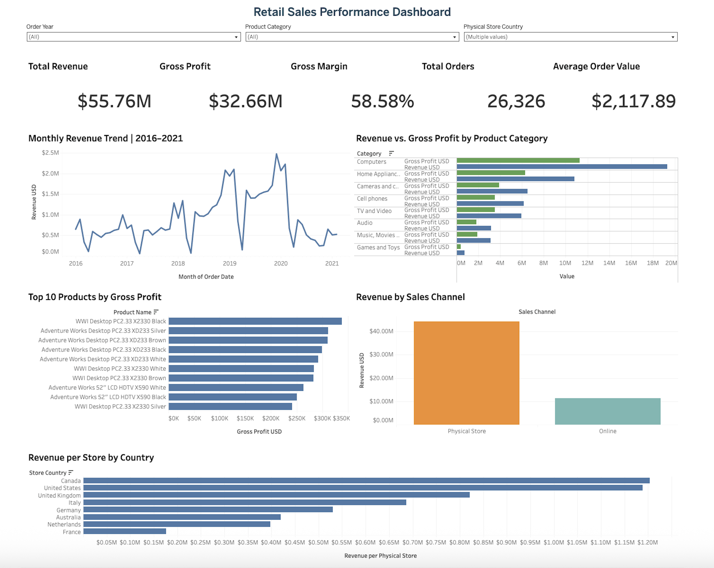
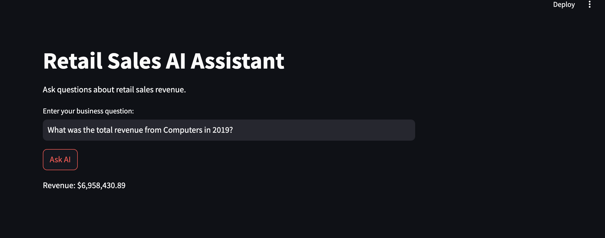

# Retail Sales Analytics

## Project Overview

In this project, I analyzed retail sales data to understand revenue trends, product performance, profitability, and sales channel performance.

I worked with multiple datasets covering sales transactions, customers, products, stores, and exchange rates. My goal was to transform the raw data into meaningful business insights using SQL, Python, and Tableau.

I also built a simple AI-powered assistant that allows users to ask revenue-related questions in natural language.

The project follows an end-to-end analytics workflow, from data preparation and validation to business analysis, dashboard development, and AI integration.

## Dataset

The analysis uses the Global Electronics Retailer dataset, which includes:

- **Sales:** Transaction-level sales information
- **Customers:** Customer details and demographics
- **Products:** Product information, categories, and pricing
- **Stores:** Store locations and sales channels
- **Exchange Rates:** Currency exchange rates

The final analysis contains **62,884 sales records**.

**Dataset Source:** [Global Electronics Retailer — Maven Analytics](https://mavenanalytics.io/data-playground/global-electronics-retailer)

### Overall Business KPIs

| KPI | Value |
|---|---:|
| Total Revenue | $55,755,479.59 |
| Total Cost | $23,092,791.21 |
| Gross Profit | $32,662,688.38 |
| Gross Profit Margin | 58.58% |

## Tools and Technologies

- **PostgreSQL / SQL:** Imported, cleaned, validated, and analyzed retail data using joins, aggregations, and business calculations.
- **Python / Pandas:** Prepared datasets, performed additional analysis, and calculated revenue using filtered data.
- **Jupyter Notebook:** Developed and documented Python analysis.
- **Tableau:** Created an interactive dashboard to visualize business performance.
- **Ollama (Llama 3.2):** Used a local language model to interpret revenue-related business questions.
- **Streamlit:** Built a simple web application for interacting with the AI Assistant.

## Project Workflow

### 1. Data Preparation and Validation — SQL

Imported the retail datasets into PostgreSQL and performed data quality checks before beginning the analysis.

The validation process included:

- Checking missing values and duplicate records
- Validating relationships between sales, customers, and products
- Cleaning product price fields
- Verifying currency exchange rate matches
- Checking sales quantities and transaction records

These checks helped ensure that the data was reliable before calculating business metrics.

### 2. Business Analysis — SQL

Used SQL to answer business questions related to revenue, profitability, products, and sales channels.

The analysis focused on:

- Total revenue, cost, and gross profit
- Gross profit margin
- Revenue and profitability by product category
- Top-performing products
- Sales performance across online and physical stores

### 3. Data Analysis — Python

Used Python and Pandas to work with the prepared retail dataset and perform additional analysis.

The cleaned dataset was also used as the source for revenue calculations in the AI Assistant.

### 4. Data Visualization — Tableau

Built an interactive Retail Sales Performance Dashboard to present business KPIs and sales insights.

### 5. AI Assistant — Ollama and Streamlit

Developed a local AI Assistant that interprets natural-language revenue questions and returns calculated results from the retail dataset.

### Key Business Insights

## Data Validation and Accuracy

Data quality and calculation accuracy were important parts of this project.

Validation included:

- Checking duplicate sales records and invalid quantities.
- Verifying relationships between sales, customers, products, and stores.
- Checking exchange-rate matches.
- Comparing revenue, cost, and gross profit calculations against SQL analysis.
- Testing the AI Assistant with different combinations of year, category, and sales-channel filters.

### AI Assistant Validation Results

| Business Question | Validated Revenue |
|---|---:|
| Total revenue across all years | $55,755,479.59 |
| Total revenue in 2020 | $9,294,632.14 |
| Computers revenue in 2019 | $6,958,430.89 |
| Online Computers revenue in 2019 | $1,500,897.15 |
| Physical Store Computers revenue in 2019 | $5,457,533.74 |
| Online revenue in 2020 | $2,069,950.90 |

All six test questions returned the expected results in the Streamlit application.

The assistant is a validated local prototype supporting revenue-related questions, rather than a production-ready analytics system.

### Overall Sales Performance

The retail business generated approximately **$55.76 million in revenue** and **$32.66 million in gross profit**, with an overall gross profit margin of **58.58%**.

### Product Category Performance

- **Computers** generated the highest revenue at approximately $19.30 million.
- **Home Appliances** ranked second with approximately $10.80 million.
- **Cameras and Camcorders** generated approximately $6.52 million.
- **Music, Movies and Audio Books** achieved the highest gross profit margin among the eight product categories at 60.98%.

### Product Profitability

The **WWI Desktop PC2.33 X2330 Black** was identified as the highest gross-profit product in the SQL analysis, generating approximately **$505,450 in gross profit**.

Desktop computers appeared frequently among the most profitable products, highlighting the importance of the Computers category to overall business performance.

### Business Implications

Based on the analysis, the business could consider:

- Investigating opportunities to sustain strong computer sales.
- Exploring growth opportunities in high-margin product categories.
- Monitoring lower-performing products to identify potential pricing, promotional, or inventory improvements.
- Using category and channel performance insights to support sales planning.

These are recommendations based on the analysis, not measured business improvements.

## Tableau Dashboard

Created an interactive **Retail Sales Performance Dashboard** using Tableau.

### Live Interactive Dashboard

[View Retail Sales Performance Dashboard on Tableau Public](https://public.tableau.com/app/profile/jyothi.kadari/viz/RetailSalesAnalyticsRevenueProfitabilitySalesChannels/RetailSalesPerformanceDashboard)

### Dashboard Preview



The dashboard helps users explore:

- Overall revenue and profitability
- Product category performance
- Sales trends over time
- Online and physical store performance
- Key business metrics

The dashboard provides a visual way to understand sales performance and identify areas that may need further investigation.

## AI-Powered Retail Sales Assistant

As an extension of the analytics project, I built a simple AI Assistant using Python, Pandas, Ollama, and Streamlit.

The goal was to make revenue information easier to access by allowing users to ask questions in everyday language instead of writing SQL queries.

### AI Assistant Preview



### How It Works

1. A user enters a revenue-related question in the Streamlit application.
2. Ollama interprets the question and extracts structured information, including the metric, year, and product category.
3. Python determines the sales channel directly from the user's question to prevent incorrect AI-generated channel filters.
4. Python validates the supported metric and extracted filters.
5. Pandas filters the retail dataset and calculates revenue.
6. Streamlit displays the calculated result.

The language model helps interpret business questions, while Python and Pandas handle filtering and financial calculations.

This separation improves reliability and makes the results easier to validate.

### Example Questions

**Question:** What was the total revenue across all years?

**Answer:** $55,755,479.59

**Question:** What was the Computers revenue in 2019?

**Answer:** $6,958,430.89

**Question:** What was the online Computers revenue in 2019?

**Answer:** $1,500,897.15

These examples were tested against the validated retail data.

### Current Limitations

- The AI Assistant currently supports revenue questions only.
- Questions can include year, product category, and sales channel filters.
- The local language model may occasionally misinterpret questions or miss filters.
- The application does not independently guarantee that every extracted filter matches the user's intent.
- Revenue calculations are performed using Pandas rather than generated by the language model.
- Results should be verified when the AI interpretation is uncertain.

## How to Run the AI Assistant

The AI Assistant runs locally using Streamlit and Ollama.

### Prerequisites

Make sure the following are installed:

- Python 3
- Ollama

### 1. Download the Project

Download or clone this GitHub repository.

Open Terminal and navigate to the project folder.

### 2. Install Python Libraries

Install the required Python libraries using:

```bash
pip install -r requirements.txt
```

### 3. Download the AI Model

Install Ollama from https://ollama.com if it is not already installed.

Download the Llama 3.2 model:

```bash
ollama pull llama3.2:3b
```

### 4. Run the Application

Make sure Ollama is running, then start the Streamlit application:

```bash
streamlit run app.py
```

The application will open in your browser.

### 5. Ask Revenue Questions

Try questions such as:

- What was the total revenue across all years?
- What was the Computers revenue in 2019?
- What was the online Computers revenue in 2019?

The application reads `retail_sales_analysis_clean.csv` and uses Pandas to calculate revenue based on the interpreted filters.

## Project Files

| File | Description |
|---|---|
| `app.py` | Streamlit AI Assistant application |
| `retail_ai_assistant.ipynb` | AI Assistant development and testing notebook |
| `retail_sales_analysis.ipynb` | Python retail sales analysis |
| `retail_sales_analysis_clean.csv` | Prepared dataset used for analysis and revenue calculations |
| `requirements.txt` | Python libraries required for the AI application |
| `.gitignore` | Rules for excluding temporary and local files from Git |
| `README.md` | Project documentation |
| `SQL/` | SQL scripts for data validation and business KPI analysis |
| `Retail_Sales_Analytics.twbx` | Tableau packaged dashboard workbook |

## Project Summary

This project helped me apply SQL, Python, Tableau, and AI tools to a complete retail analytics workflow.

It also reinforced the importance of validating data, translating business questions into calculations, presenting insights clearly, and checking AI-generated interpretations against actual data.

The result is an analytics portfolio project that combines traditional business intelligence with a practical, locally running AI Assistant.